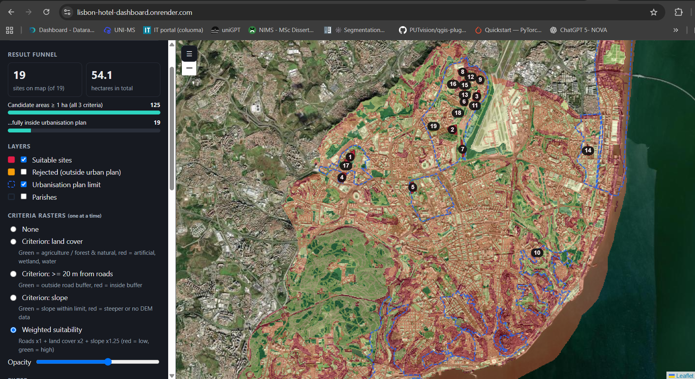
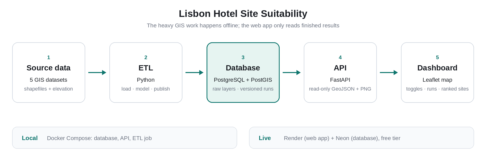

# Lisbon Hotel Site Suitability

An end-to-end geospatial system that finds suitable land for a hotel in Lisbon.

[](https://hub.xerj.org/contributors/OceeDiTT)

**Live demo:** [Access Dashboard here](https://lisbon-hotel-dashboard.onrender.com/) (free hosting sleeps when idle, so the first load can take about a minute)



## What it does

A site is a suitable hotel location if it meets all of these:

| Criterion | Rule |
|---|---|
| Roads | At least 20 m from any street |
| Land cover | Agriculture or forest/natural (top-level classes 2 and 3) |
| Slope | 10 % or less |
| Size | At least 1 ha of contiguous land |
| Planning | Fully inside the urbanisation plan |

On the original data this gives **125 candidate areas**, of which **19 sites (about 54 ha)** lie inside the urbanisation plan.

Every ETL run is stored with its parameters, input lineage and QA counts, so scenarios (for example a 30 m road buffer) can be compared in the dashboard's run selector.

## Dashboard features

- Toggle layers: suitable sites, rejected candidates (outside the urbanisation plan), urbanisation plan limit, parishes
- View one criterion raster at a time (roads, land cover, slope, weighted suitability) with an opacity slider
- Three basemaps (streets, satellite, light)
- Minimum-area filter and run selector
- Result funnel (125 → 19), criteria pass rates, sites by parish
- Ranked list of the top 10 sites by area; click a row to zoom to the site
- Warning banner when cells have no slope data

## Architecture



The heavy GIS work happens offline in the ETL. The web app only reads finished results, which is why it runs on a small free server.

**Coordinate systems:** analysis in EPSG:3763 (Portugal TM06, metres), GeoJSON served in EPSG:4326, raster overlays rendered in EPSG:3857 to match Leaflet.

## Tech stack

PostgreSQL 16 + PostGIS · Python 3.12 · GeoPandas, Shapely, Rasterio, Rasterstats · SQLAlchemy, psycopg 3 · FastAPI, Uvicorn · Pillow · Leaflet · Docker Compose

## Repository layout

```
api/                 FastAPI app (main.py)
etl/                 config.py, extract_load.py, transform.py, publish.py, raster_ops.py, run.py
sql/                 01_schema.sql, 02_views.sql
web/index.html       the dashboard (single file)
tests/               unit tests for the raster maths
Dockerfile           API + dashboard image
Dockerfile.etl       ETL image
docker-compose.yml   db, api, and a one-shot etl service
render.yaml          Render blueprint (free web service)
requirements-*.txt
```

## Data (not included)

Source datasets are not in this repository. Place your files in this layout:

```
data/Lx_Streets/gis_osm_roads_free_1.shp
data/Lx_elevation/elevation_lx.tif
data/Lx_parishes/Lx_parishes.shp
data/Lx_land_cover/Lx_land_cover_N5.shp
data/Lx_urbanization_plan/Limit_urban_plan.shp
```

Keep each shapefile's `.dbf`, `.shx` and `.prj` alongside it. The elevation model must be in a projected CRS (metres). Land cover needs a code column (default `COSN5`) whose first character is the top-level class. The parish name column is auto-detected; check `raw.parishes.parish_name` after the first load.

## Quick start (local)

Requires Docker.

```bash
docker compose up -d db api
docker compose run --rm etl        # loads raw layers, runs the model, publishes results
```

Open http://localhost:8000. The first ETL run is slow because it loads the roads layer (about 870k features).

Re-run with different parameters (each creates a new, selectable run):

```bash
docker compose run --rm etl --skip-raw --label "30 m buffer" --set road_buff=30 slope_max=8
```

### ETL options

| Flag | Meaning |
|---|---|
| `--data-dir PATH` | Folder containing the datasets (default `data`) |
| `--skip-raw` | Reuse `raw.*` tables already in the database |
| `--init-only` | Only create the schema and views |
| `--set K=V ...` | Override model parameters |
| `--label TEXT` | Name for the run |

### Model parameters

| Parameter | Default | Meaning |
|---|---|---|
| `cell_size` | 20 | Grid resolution (m) |
| `road_buff` | 20 | Minimum distance from streets (m) |
| `slope_max` | 10 | Maximum slope (%) |
| `min_area` | 10000 | Minimum contiguous area (m²) |
| `w_roads`, `w_landc`, `w_slope` | 1, 2, 1.25 | Weights for the weighted-suitability raster |
| `code_field` | `COSN5` | Land-cover code column |
| `lc_suitable_levels` | `2,3` | Suitable top-level land-cover classes |
| `missing_slope_suitable` | `false` | Treat cells with no slope value as suitable |
| `crs` | `EPSG:3763` | Analysis CRS |

## API

All endpoints are read-only. Most accept an optional `run_id` (default: latest run).

| Endpoint | Returns |
|---|---|
| `GET /api/health` | `{"status":"ok"}` |
| `GET /api/runs` | List of runs |
| `GET /api/summary` | Parameters, lineage, QA counts, funnel numbers |
| `GET /api/sites?stage=final\|rejected\|all` | Sites as GeoJSON |
| `GET /api/layers/parishes` | Parishes as GeoJSON |
| `GET /api/layers/urban-plan` | Urbanisation plan as GeoJSON |
| `GET /api/overlays` | Overlay metadata and map bounds |
| `GET /api/overlays/{name}.png` | Criterion raster image |

## Data model

- `analysis.run`: one row per ETL execution (parameters, sources, QA, candidate and final counts)
- `analysis.site`: candidate areas of at least 1 ha, with geometry, area, scores, `in_urban_plan` flag and parish. Final sites are the ones flagged true
- `analysis.overlay`: pre-rendered PNGs of the criterion rasters with their bounds
- `raw.*`: source layers as loaded, with spatial indexes

## Deploying on free hosting

Free setup: **Neon** (free Postgres with PostGIS) + **Render** (free web service). Check each provider's current free-tier limits before you start.

1. **Create the database on Neon** and copy its connection string. In the SQL editor run:
   ```sql
   CREATE EXTENSION IF NOT EXISTS postgis;
   CREATE SCHEMA IF NOT EXISTS raw;
   ```
2. **Copy your local results into Neon.** The dashboard only needs the results, parishes and urbanisation plan, so the large roads and land-cover tables stay local:
   ```bash
   docker compose exec -T db pg_dump -U hotel -d hotel --no-owner --no-acl -t raw.parishes -t raw.urban_plan > raw.sql
   docker compose exec -T db pg_dump -U hotel -d hotel --no-owner --no-acl -n analysis > analysis.sql
   docker compose exec -T db psql "NEON_URL" -v ON_ERROR_STOP=1 < raw.sql
   docker compose exec -T db psql "NEON_URL" -v ON_ERROR_STOP=1 < analysis.sql
   ```
   On Windows PowerShell the `<` operator does not work. Use Git Bash or WSL, or pipe the file: `Get-Content raw.sql | docker compose exec -T db psql "NEON_URL"`.
3. **Push this repository to GitHub** (private is fine; Render can be granted access to one repo).
4. **Create the service on Render:** New → Blueprint → select the repo. When prompted, paste the Neon connection string as `DATABASE_URL`. It is marked `sync: false` in `render.yaml`, so it is never stored in the repo.
5. **Verify:** open `https://<your-service>.onrender.com/api/health`, then the main URL.

Never commit the connection string. Updating the live results is a manual step: re-run the ETL locally and re-import `analysis.sql`.

## Troubleshooting

| Symptom | Cause and fix |
|---|---|
| `libexpat.so.1: cannot open shared object file` in the ETL | Missing system library in the slim image. `Dockerfile.etl` installs `libexpat1`; rebuild with `docker compose build etl` |
| `Column named geometry already exists` | Fixed in `extract_load.py` (only renames when needed). Update the file and rebuild |
| Dashboard loads but shows no data on a hosted database | Check `/api/runs`, then the host's logs. If PostGIS functions are reported as missing, the app's connection may not have `public` on its search path. The API already calls PostGIS as `public.ST_...` to avoid this |
| Criterion rasters do not appear | Overlay bounds with latitude and longitude swapped (older ETL versions). Check `/api/overlays`: `south` should be about 38.7 and `west` about -9.2 |
| "API key required" on a basemap | That tile provider now needs a key. The light basemap uses an Esri service that does not |
| Slow first load on the live site | The free web service sleeps when idle and takes about a minute to wake |

## Testing

```bash
pip install pytest numpy
pytest tests
```

The tests cover the pure-numpy raster maths (slope, reclassification, weighting). The SQL and spatial steps are verified by running the pipeline, not by automated tests.

## Known limitations

- **All final sites have the same weighted score (4.25).** A site only exists where every criterion passes, so the weighted sum cannot rank sites; they are ranked by area. Meaningful scoring needs a score threshold instead of all-criteria-pass, or extra criteria (transit, attractions).
- **Cells without slope data are treated as unsuitable** by default (the original analysis counted 46,569). This may under-count usable land. Change it with `--set missing_slope_suitable=true`.
- The elevation model is read from a file, not stored in the database; its path, size and modified time are recorded in `analysis.run.sources`.
- A site is assigned to the parish containing a point on its surface; sites that straddle parishes get one parish.
- The dashboard has no login. Anyone with the link can view it.

## Roadmap ideas

Score-based ranking and additional criteria, automated ETL and database import in CI, authentication, automated tests for the SQL and spatial steps.

## License

MIT License
